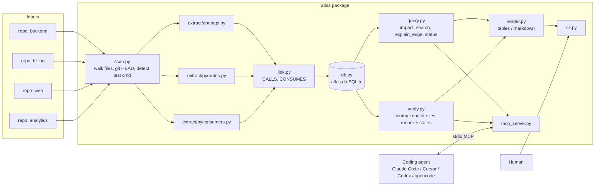
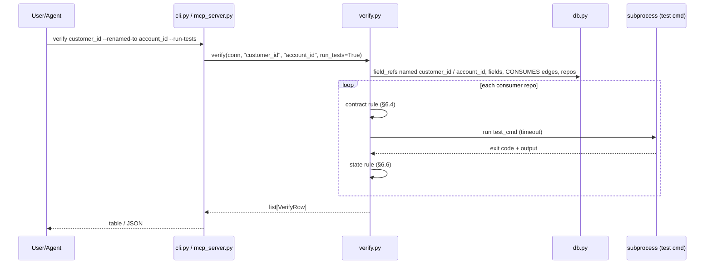

# 02 — Architecture and technical design

Everything in this document is binding for the MVP. Names, signatures, table columns and rules
here are the ones every task in `04-mvp-implementation-plan.md` uses. Do not rename them.

## 1. Stack (smallest reliable)

| Concern | Choice | Why | Rejected |
|---|---|---|---|
| Language | Python ≥ 3.11 | `ast` parses Python with no dependency; most participants and users have it | TypeScript (needs tree-sitter/ts compiler for parsing) |
| Parsing | `ast` (stdlib) + `yaml`/`json` | Zero-dependency, exact line numbers | tree-sitter (extra native dep; add in roadmap for other languages) |
| Storage | `sqlite3` (stdlib), one file `atlas.db` | Queryable, portable, inspectable with any SQLite viewer | Neo4j/Kuzu (infrastructure for a small graph) |
| CLI | `argparse` (stdlib) | No dependency | typer/click (fine, but unnecessary) |
| Agent interface | `mcp>=2,<3` (`MCPServer`, stdio) | Standard across agents; verified round-trip | custom HTTP API |
| Tests | `pytest` | Standard | — |
| Packaging | `pyproject.toml`, `[project.scripts] atlas = "atlas.cli:main"` | `pipx`/`uv tool install` works | — |

Runtime dependencies: `pyyaml>=6`, `mcp>=2,<3`. Dev: `pytest>=8`.

## 2. High-level architecture



Component responsibilities:
- `scan.py` — orchestration only: find files, call extractors, call linker, write to DB. No parsing logic.
- `extract/*` — pure functions: `(repo_name, repo_root) -> ExtractResult`. No DB, no I/O except reading files.
- `link.py` — pure function over all nodes: produce cross-repo edges.
- `db.py` — the only module that imports `sqlite3`.
- `query.py`, `verify.py` — read the DB and compute results as dataclasses. `verify.py` is the only module that runs subprocesses.
- `render.py` — turns dataclasses into text. No logic.
- `cli.py`, `mcp_server.py` — thin adapters. They never compute anything themselves.

Trust boundaries: repo contents are untrusted data (parsed, never executed) **except** the test command, which Atlas runs on the user's explicit request (`--run-tests` or MCP `run_tests=true`) with a timeout and output cap. The MCP server trusts its client (the local agent).

## 3. Data model (SQLite)

```sql
CREATE TABLE IF NOT EXISTS repos (
  id          INTEGER PRIMARY KEY,
  name        TEXT NOT NULL UNIQUE,        -- directory basename, e.g. "billing"
  path        TEXT NOT NULL,               -- absolute path
  commit_sha  TEXT,                        -- git HEAD or NULL if not a git repo
  test_cmd    TEXT,                        -- detected or from .atlas.yaml; NULL if none
  scanned_at  TEXT NOT NULL                -- ISO-8601 UTC
);

CREATE TABLE IF NOT EXISTS nodes (
  id      INTEGER PRIMARY KEY,
  repo_id INTEGER NOT NULL REFERENCES repos(id) ON DELETE CASCADE,
  kind    TEXT NOT NULL,                   -- 'endpoint' | 'field' | 'http_call' | 'field_ref'
  name    TEXT NOT NULL,                   -- endpoint: "GET /users/{user_id}"; field/field_ref: "customer_id"; http_call: "GET /users/{}"
  file    TEXT NOT NULL,                   -- path relative to repo root
  line    INTEGER NOT NULL,
  meta    TEXT NOT NULL DEFAULT '{}',      -- JSON with sorted keys (see §4)
  UNIQUE (repo_id, kind, name, file, line, meta)   -- meta included: a Flask route with methods=["GET","DELETE"] yields two field nodes on the same line
);
CREATE INDEX IF NOT EXISTS nodes_kind_name ON nodes(kind, name);

CREATE TABLE IF NOT EXISTS edges (
  id          INTEGER PRIMARY KEY,
  src_id      INTEGER NOT NULL REFERENCES nodes(id) ON DELETE CASCADE,
  dst_id      INTEGER NOT NULL REFERENCES nodes(id) ON DELETE CASCADE,
  kind        TEXT NOT NULL,               -- 'EXPOSES' | 'CALLS' | 'CONSUMES'
  confidence  TEXT NOT NULL,               -- 'exact' | 'inferred'
  ev_file     TEXT NOT NULL,               -- evidence: file relative to src repo root
  ev_line     INTEGER NOT NULL,
  ev_snippet  TEXT NOT NULL,               -- the source line, stripped, max 200 chars
  extractor   TEXT NOT NULL,               -- 'openapi' | 'pyroutes' | 'pyconsumers' | 'link'
  reason      TEXT NOT NULL DEFAULT ''     -- human-readable why, e.g. "same file calls GET /users/{}"
);
CREATE INDEX IF NOT EXISTS edges_dst ON edges(dst_id);
CREATE INDEX IF NOT EXISTS edges_src ON edges(src_id);
```

Edge direction (always "from the thing that depends → to the thing it depends on", except EXPOSES):
- `EXPOSES`: endpoint → field (producer repo, within one repo).
- `CALLS`: http_call → endpoint (consumer → producer, cross-repo).
- `CONSUMES`: field_ref → field (consumer → producer, cross-repo).

Lifecycle: `scan` deletes the repo row (cascade) and re-inserts. No migrations in MVP; `init_schema` is idempotent. Schema version stored in `PRAGMA user_version = 1`.

## 4. In-memory types (`atlas/models.py`)

```python
import json
from dataclasses import dataclass, field

NODE_KINDS = ("endpoint", "field", "http_call", "field_ref")
EDGE_KINDS = ("EXPOSES", "CALLS", "CONSUMES")
CONFIDENCES = ("exact", "inferred")
STATES = ("pass", "fail", "not_run", "unknown")
HTTP_METHODS = ("GET", "POST", "PUT", "PATCH", "DELETE")

@dataclass(frozen=True)
class Node:
    repo: str
    kind: str
    name: str
    file: str          # relative to repo root, posix separators
    line: int
    meta: dict = field(default_factory=dict, compare=False, hash=False)

    @property
    def meta_json(self) -> str:
        return json.dumps(self.meta, sort_keys=True)

    @property
    def key(self) -> str:            # stable identity used before DB ids exist; matches the DB UNIQUE constraint
        return f"{self.repo}|{self.kind}|{self.name}|{self.file}|{self.line}|{self.meta_json}"

@dataclass(frozen=True)
class Evidence:
    file: str
    line: int
    snippet: str
    extractor: str
    reason: str = ""

@dataclass(frozen=True)
class Edge:
    src_key: str
    dst_key: str
    kind: str
    confidence: str
    evidence: Evidence

@dataclass
class ExtractResult:
    nodes: list[Node] = field(default_factory=list)
    edges: list[Edge] = field(default_factory=list)
    skipped: list[str] = field(default_factory=list)   # "file: reason"

@dataclass
class RepoInfo:
    name: str
    path: str
    commit_sha: str | None
    test_cmd: str | None

@dataclass
class ImpactRow:
    repo: str
    file: str
    line: int
    snippet: str
    confidence: str
    via: str            # endpoint name for exact, "name match" for inferred
    edge_id: int

@dataclass
class ImpactResult:
    symbol: str
    producers: list[dict]      # {"repo","endpoint","file","line"}
    consumers: list[ImpactRow]

@dataclass
class VerifyRow:
    repo: str
    evidence: str       # "file:line" of the strongest ref
    confidence: str     # best confidence among this repo's refs
    contract: str       # "pass" | "fail" | "n/a"
    tests: str          # "pass" | "fail" | "not_run" | "unknown"
    state: str          # final, one of STATES
    reason: str
    test_output: str = ""   # last 30 lines, only when tests ran
```

`meta` JSON per kind:
- endpoint: `{"method": "GET", "path": "/users/{user_id}", "pattern": "^/users/[^/]+$"}`
- field: `{"endpoint": "GET /users/{user_id}"}`
- http_call: `{"method": "GET", "path": "/users/{}", "library": "requests"}`
- field_ref: `{"access": "subscript" | "get" | "attr", "function": "charge_user" | ""}`

## 5. Extraction rules

### 5.1 File discovery (`scan.py`)
- Walk `repo_root` recursively; skip directories named `.git .hg .svn node_modules .venv venv env dist build __pycache__ .mypy_cache .pytest_cache site-packages`.
- Python files: `*.py`. OpenAPI candidates: files named `openapi.yaml|openapi.yml|openapi.json|swagger.yaml|swagger.json` (any depth).
- Repo name = `Path(repo_root).resolve().name`. If two inputs share a basename, append `-2`, `-3`.
- `commit_sha = git -C repo rev-parse HEAD` (None on error).
- Test command: if `.atlas.yaml` exists with `test_cmd`, use it; else if any of `pytest.ini`, `tests/`, `setup.cfg` containing `[tool:pytest]`, `pyproject.toml` containing `pytest` → `python -m pytest -q`; else None.

### 5.2 OpenAPI (`extract/openapi.py`) — extractor id `openapi`
- Load YAML/JSON. Ignore files without a top-level `paths` dict.
- For each `paths[path][method]` where method in lowercase HTTP_METHODS: endpoint node `name=f"{METHOD} {path}"`, `line` = line of the `path` key (YAML: find first line matching `^\s*['"]?{path}['"]?:`; JSON: same search on raw text; fallback 1).
- Response schema: first key of `responses` that starts with `2` → `content["application/json"]["schema"]`. Resolve `$ref` of form `#/components/schemas/X` (one level; nested `$ref` inside properties also resolved one level). If `type: array`, use `items`. Collect `properties` keys → field nodes `name=key`, `line` = line of the property key if findable else endpoint line, `meta={"endpoint": endpoint.name}`.
- Edge `EXPOSES` endpoint→field, `exact`, evidence `(file, field.line, snippet, "openapi", "response schema property")`.

### 5.3 Python routes (`extract/pyroutes.py`) — extractor id `pyroutes`
- For each `FunctionDef`/`AsyncFunctionDef` with a decorator that is a `Call` whose func is `Attribute` with attr in `get|post|put|patch|delete|route` and first arg a string constant:
  - `route`: method from `methods=[...]` keyword (each uppercase string) or `GET` default. One endpoint node per method.
  - path = the string constant. `pattern` = `"^" + re.sub(r"\{[^}]+\}", "[^/]+", path) + "$"`, `<int:id>`-style Flask params also → `[^/]+`.
- Fields: walk the function body for `Return` whose value is a `Dict` with all-constant string keys, or a `Call` to `jsonify`/`dict` with a `Dict` first arg / keyword args. Each key → field node (line = key's line). `EXPOSES` edge `exact`, reason `"dict literal in return"`.
- Also: `return SomeModel(**...)` or returning a variable → no fields (skipped list gets `"file:line: non-literal return"`).

### 5.4 Python consumers (`extract/pyconsumers.py`) — extractor id `pyconsumers`
- HTTP calls: `Call` nodes where func is `Attribute(value=Name|Attribute id in {requests, httpx, client, session}, attr in get|post|put|patch|delete)` or `Name id == "urlopen"` / `Attribute attr == "urlopen"`. First positional arg or `url=` keyword:
  - `Constant` str → path = urlpath(str) (strip scheme/host via `urllib.parse.urlsplit(...).path` if it has `://`, else as-is).
  - `JoinedStr` (f-string) → concatenate: `Constant` parts verbatim, `FormattedValue` → `{}`. If result starts with `{}` (base URL variable), strip the leading `{}`. Then strip scheme/host as above.
  - `BinOp` with `+` of constants/names → same rule (Name → `{}`).
  - anything else → skip with reason.
  - Normalize: remove trailing `/` (except root), collapse `//`. Node `name=f"{METHOD} {path}"`, meta `{"method","path","library"}`.
  - Method: from attr name uppercase; `urlopen` → GET.
- Field refs (in every function and module scope):
  - `Subscript(value=*, slice=Constant(str))` → `access="subscript"`.
  - `Call(func=Attribute(attr="get"), args[0]=Constant(str))` → `access="get"` (only when the attribute's value is not `requests|httpx|client|session`, to avoid confusing with HTTP get).
  - `Attribute(attr=X)` where X ∈ `known_fields` (set passed in; from producer field names) → `access="attr"`.
  - Node `name=<string>`, `line`, `meta.function` = enclosing function name or "".
- Signature: `extract_py_consumers(repo_name, repo_root, known_fields: set[str]) -> ExtractResult`.

### 5.5 Linking (`link.py`)
```python
def link(nodes: list[Node], snippets: dict[str, str]) -> list[Edge]:
    """nodes: all nodes from all repos. snippets: node.key -> source line text. Returns CALLS + CONSUMES edges."""
```
- `CALLS`: for each http_call H and endpoint E in a **different** repo: if `H.meta.method == E.meta.method` and `re.fullmatch(E.meta.pattern, H.meta.path.replace("{}", "x"))` → edge `exact`, evidence (H.file, H.line, snippet, "link", f"{H.name} matches {E.name}").
- `CONSUMES`: for each field_ref R: candidates = field nodes F with `F.name == R.name` in a different repo.
  - If any http_call H in the same repo **and same file** as R has a CALLS edge to endpoint E where `F.meta.endpoint == E.name` → edge R→F `exact`, reason `f"same file calls {E.name}"`.
  - Else, for each candidate F → edge R→F `inferred`, reason `"name match only"`.
  - If no candidates → no edge (R stays an orphan node; still searchable).
- Linking runs over the full node set after all repos are extracted, so order of repos doesn't matter.

## 6. Verification rules (`verify.py`)

```python
def verify(conn, symbol: str, renamed_to: str | None = None,
           run_tests: bool = False, timeout: int = 120) -> list[VerifyRow]
```
Per consumer repo R (a repo with ≥1 `field_ref` named `symbol` or, if `renamed_to`, named `renamed_to` with an exact CONSUMES edge; **excluding** repos that themselves expose `symbol` or `renamed_to` as a `field` — a producer is never its own consumer):
1. `refs_old` = field_refs named `symbol` in R; `refs_new` = field_refs named `renamed_to` in R (or empty).
2. `producer_has_old` = any `field` node named `symbol` (any repo ≠ R); `producer_has_new` likewise.
3. `confidence` = `"exact"` if any CONSUMES edge from refs_old ∪ refs_new is exact, else `"inferred"`.
4. `contract`:
   - `refs_old` non-empty and not `producer_has_old` → `"fail"` (reason: "still references `symbol`, which no producer exposes")
   - `refs_old` non-empty and `producer_has_old` → `"pass"` (reason: "`symbol` still exposed")
   - `refs_old` empty and `refs_new` non-empty and `producer_has_new` → `"pass"` (reason: "updated to `renamed_to`")
   - otherwise → `"n/a"`.
5. `tests`:
   - `run_tests` false → `"not_run"` (reason suffix: "tests not run")
   - R.test_cmd is None → `"not_run"` ("no test command detected")
   - run `subprocess.run(test_cmd, shell=True, cwd=R.path, capture_output=True, text=True, timeout=timeout)`; exit 0 → `"pass"`, else `"fail"`; `TimeoutExpired`/`OSError` → `"unknown"` ("test command timed out/failed to start"). Keep last 30 lines of stdout+stderr in `test_output`.
6. `state` (in this order):
   - if `confidence == "inferred"` → `"unknown"` (never pass/fail on a guess)
   - elif `contract == "fail"` or `tests == "fail"` → `"fail"`
   - elif `tests == "pass"` → `"pass"`
   - elif `contract == "pass"` and `tests == "not_run"` → `"not_run"`
   - else → `"unknown"`
7. `evidence` = `file:line` of the first exact ref, else first ref. Rows sorted by repo name.
8. `reason` = (`"name match only; "` if confidence is inferred, else `""`) + contract reason from step 4 (for `"n/a"`: `"no contract to check"`) + (`"; tests: " + detail` only when tests is `unknown`). Examples: `name match only; still references customer_id, which no producer exposes`; `still references customer_id, which no producer exposes`; `updated to account_id`.
9. Test command execution: if `test_cmd` starts with `python `, replace that token with `sys.executable` at run time so the same interpreter (and installed `pyyaml`) is used even when `python` is not on PATH.

Invariant (NFR-006): `state == "pass"` ⇒ `tests == "pass"` and `confidence == "exact"`.

## 7. Impact query (`query.py`)

```python
def impact(conn, symbol: str) -> ImpactResult
def search(conn, text: str, limit: int = 50) -> list[dict]      # {"id","repo","kind","name","file","line"}
def explain_edge(conn, edge_id: int) -> dict | None             # edge + src node + dst node + evidence
def status(conn) -> dict   # {"db": path, "repos": [{"name","path","commit_sha","test_cmd","scanned_at"}], "nodes": {kind: n}, "edges": {kind: n}}
```
`status` gets the DB path from `conn.execute("PRAGMA database_list").fetchone()[2]`. `impact` excludes CONSUMES rows whose consumer repo also exposes the field (same rule as verify).
`impact`: producers = field nodes named `symbol` joined to their endpoint (via meta.endpoint) with repo/file/line; consumers = all CONSUMES edges whose dst is one of those fields, one `ImpactRow` per edge, `via` = endpoint name (exact) or `"name match"` (inferred). If no producer exposes `symbol` but field_refs exist, consumers are still listed by name (confidence `inferred`, via `"name match"`) so the user sees orphans.

## 8. Core sequence (verify with tests)



## 9. CLI contract (`cli.py`)

```
atlas scan <repo_path>... [--db atlas.db] [-v]
atlas status [--db] [--json]
atlas impact <symbol> [--db] [--json]
atlas verify <symbol> [--renamed-to NEW] [--run-tests] [--timeout 120] [--db] [--json]
atlas search <text> [--db] [--json]
atlas explain-edge <id> [--db] [--json]
atlas serve [--db]            # MCP stdio server
atlas explain <symbol> [...]  # optional, FR-015
```
- `--db` default: env `ATLAS_DB` if set, else `./atlas.db`.
- Exit codes: 0 success; 1 usage/DB missing; 2 verify had any `fail` row (so CI can gate).
- Human output = tables from `render.py`; `--json` = `json.dumps(dataclasses.asdict(...), indent=2)`.

## 10. MCP contract (`mcp_server.py`)

Server name `atlas`. Tools (all return `dict[str, Any]`):
- `atlas_status() -> status dict`
- `atlas_impact(symbol: str) -> ImpactResult as dict`
- `atlas_verify(symbol: str, renamed_to: str | None = None, run_tests: bool = False) -> {"rows": [VerifyRow dicts], "summary": {"pass": n, "fail": n, "not_run": n, "unknown": n}}`
- `atlas_search(text: str) -> {"results": [...]}`
- `atlas_explain_edge(edge_id: int) -> edge dict or {"error": "not found"}`

Tool functions are named `status`, `impact`, `verify`, `search`, `explain_edge` inside the server; clients prefix them with the server name. Logging goes to stderr only. DB path from `--db` or `ATLAS_DB`.

## 11. Rendering (`render.py`)

```python
def render_impact(r: ImpactResult) -> str
def render_verify(rows: list[VerifyRow]) -> str
def render_status(s: dict) -> str
def render_table(headers: list[str], rows: list[list[str]]) -> str   # plain aligned columns, no deps
```
Verify table columns: `Consumer | Evidence | Confidence | Contract | Tests | State | Reason`.
Impact output: a producers block, then a consumers table `Repo | File:Line | Confidence | Via | Snippet`.

## 12. Repository layout

```
atlas-repo-graph/
├── pyproject.toml
├── README.md · LICENSE (MIT) · CONTRIBUTING.md · .gitignore
├── .mcp.json                 # Claude Code format
├── opencode.json             # opencode format
├── atlas/
│   ├── __init__.py           # __version__ = "0.1.0"
│   ├── models.py             # §4
│   ├── db.py                 # §3: open_db(path) -> Connection, init_schema, replace_repo(conn, RepoInfo, nodes, edges, snippets)
│   ├── scan.py               # §5.1: scan_repos(paths, db_path, verbose) -> dict summary
│   ├── extract/
│   │   ├── __init__.py
│   │   ├── openapi.py        # §5.2 extract_openapi(repo_name, repo_root) -> ExtractResult
│   │   ├── pyroutes.py       # §5.3 extract_py_routes(repo_name, repo_root) -> ExtractResult
│   │   └── pyconsumers.py    # §5.4 extract_py_consumers(repo_name, repo_root, known_fields) -> ExtractResult
│   ├── link.py               # §5.5
│   ├── query.py              # §7
│   ├── verify.py             # §6
│   ├── render.py             # §11
│   ├── cli.py                # §9
│   ├── mcp_server.py         # §10
│   └── explain.py            # FR-015 (optional)
├── scripts/
│   └── mcp_check.py          # starts `atlas serve`, lists tools, calls status (no agent needed)
├── examples/
│   ├── README.md · demo.sh
│   ├── backend/   app.py openapi.yaml tests/
│   ├── billing/   charge.py tests/
│   ├── web/       profile.py tests/
│   └── analytics/ report.py
├── tests/
│   ├── fixtures/ (mini repos used by unit tests)
│   ├── test_models.py test_db.py test_openapi.py test_pyroutes.py test_pyconsumers.py
│   ├── test_link.py test_scan.py test_query.py test_verify.py test_render.py test_cli.py test_mcp.py
└── docs/
    ├── how-states-are-decided.md
    └── adding-an-extractor.md
```

## 13. Important invariants
- I1. Every edge row has non-empty `ev_file`, `ev_snippet`, `extractor`.
- I2. `state == pass` only if tests actually ran and passed and confidence is exact.
- I3. Extractors never raise on bad input; they append to `skipped`.
- I4. `scan` is idempotent: scanning the same repos twice yields identical counts.
- I5. `mcp_server.py` never prints to stdout except via the MCP transport.
